# Evidencias - Clase 17

## Información del Proyecto Recibido

- **Grupo:**
  - Mamani Sandoval Gabriel
  - Justiniano Becerra Ruben Orestes
- **Proyecto:** TRUEQUE U
- **Repositorio:** [https://github.com/gadrilee/2ndProject](https://github.com/gadrilee/2ndProject)

---

## Comandos Utilizados para Levantar el Entorno

### 1. Backend

Ejecutado en la carpeta `backend/`:

```bash
cd backend
npm i
npm run seed
npm run dev
```

* **Estado:** Servidor activo en `http://localhost:3000` con sincronización exitosa de base de datos SQLite.

### 2. Frontend

Ejecutado en la carpeta `frontend/`:

```bash
cd frontend
npm i
npm run dev
```

* **Estado:** Aplicación Vite iniciada y disponible localmente en `http://localhost:5173/`.

---

## Evidencias de Ejecución en Localhost

### 1. Terminal Backend
Ejecución de `npm run dev`, conexión a SQLite y levantamiento del servidor en el puerto 3000.

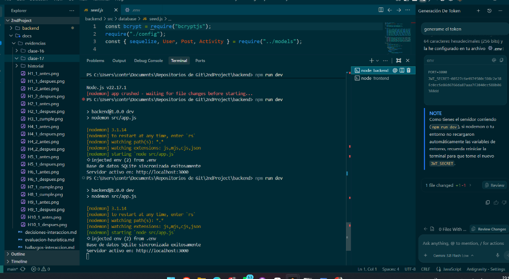

### 2. Terminal Frontend
Instalación de dependencias con `npm i` y ejecución del servidor de desarrollo Vite con `npm run dev`.

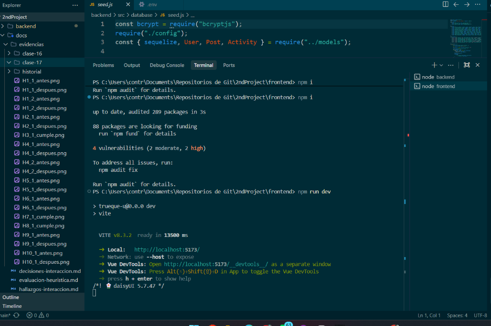

### 3. Pantalla de Inicio de Sesión (Login)
Acceso inicial en `http://localhost:5173/login`.

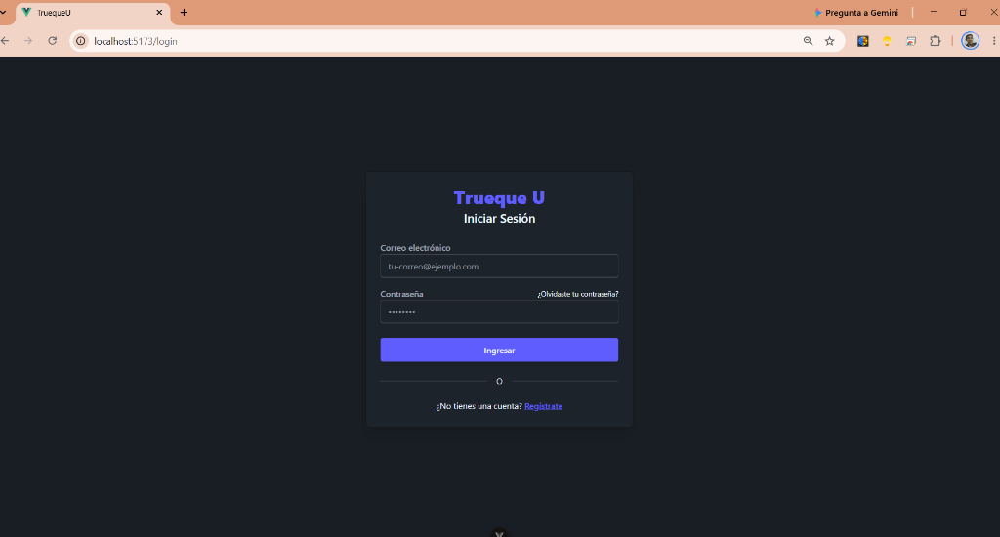

---

## Inicio de Sesión y Acceso al Dashboard

Una vez autenticado con las credenciales de usuario, el sistema redirige a la vista principal **Explorar** (`/dashboard`), permitiendo visualizar los objetos publicados y su disponibilidad.

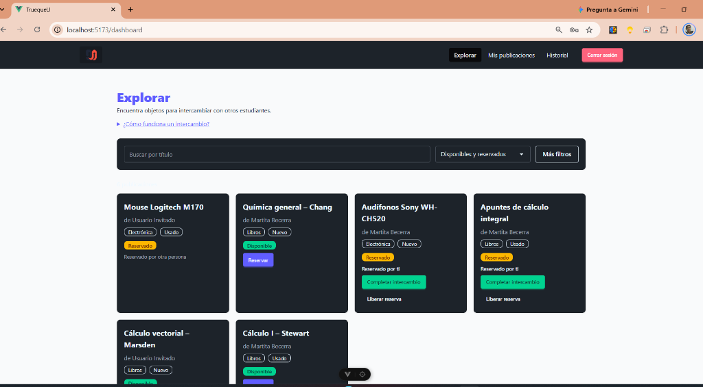

---

## Flujo de Reserva de Objetos

### 1. Estado Inicial: Publicación Disponible
El objeto cuenta con la etiqueta **Disponible** y el botón **Reservar**.

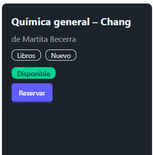

### 2. Estado Reservado: Reservado por el Usuario
Al presionar el botón de reserva, el estado cambia a **Reservado** (*"Reservado por ti"*) y se habilitan las acciones **Completar intercambio** y **Liberar reserva**.

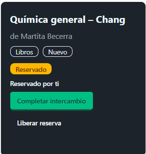

### 3. Código que gestiona la Reserva

#### Frontend (`frontend/src/views/DashboardView.vue`):
```javascript
async function handleToggleReservation(post) {
    const reserving = post.state === "disponible";
    actionError.value = null;
    completedPost.value = null;
    try {
        await postsStore.toggleReservation(post.id);
    } catch (err) {
        if (err.network) {
            actionError.value = {
                title: reserving ? `No se pudo reservar "${post.title}"` : `No se pudo liberar la reserva de "${post.title}"`,
                text: err.message,
            };
            return;
        }
        actionError.value = reserving
            ? {
                  title: `No se pudo reservar "${post.title}"`,
                  text: "Otra persona lo reservó antes que tú o ya fue intercambiado. Actualizamos la lista: elige otro objeto disponible.",
                  canShowAvailable: true,
              }
            : { title: `No se pudo liberar la reserva de "${post.title}"`, text: err.message };
    }
    loadPosts();
}
```

#### Frontend Store (`frontend/src/stores/posts.js`):
```javascript
async function toggleReservation(id) {
    const res = await request(`${API_URL}/posts/${id}/reservation`, {
        method: "PATCH",
        headers: getHeaders(),
    });

    const data = await res.json();
    if (!res.ok) {
        throw new Error(data.message || data.error || "Error al reservar la publicación");
    }
    const index = posts.value.findIndex((p) => p.id === id);
    if (index !== -1 && data.post) {
        posts.value[index] = data.post;
    }
    return data;
}
```

#### Backend Controller (`backend/src/controllers/post.controller.js`):
```javascript
exports.toggleReservation = async (req, res) => {
    const post = await Post.findByPk(req.params.id);
    if (!post) throw new HttpError(404, "Publicación no encontrada.");

    const error = getReserveError(post, req.user.id);
    if (error) {
        const status = post.state === "intercambiado" ? 400 : 403;
        throw new HttpError(status, error);
    }

    if (post.state === "reservado") {
        const otherId = req.user.id === post.userId ? post.reservedById : post.userId;
        await post.update({ state: "disponible", reservedById: null });
        await Activity.create({
            userId: req.user.id,
            type: "reserva_liberada",
            postId: post.id,
            postTitle: post.title,
            otherUserName: await getUserName(otherId),
        });
        return res.json({ message: "Reserva liberada", post });
    }

    await post.update({ state: "reservado", reservedById: req.user.id });
    await Activity.create({
        userId: req.user.id,
        type: "reservado",
        postId: post.id,
        postTitle: post.title,
        otherUserName: await getUserName(post.userId),
    });
    res.json({ message: "Publicación reservada.", post });
};
```

---

## Flujo de Confirmación de Intercambio

### 1. Confirmación de Cierre de Intercambio
Al hacer clic en **Completar intercambio**, el sistema muestra un cuadro de diálogo nativo de confirmación advirtiendo que la acción es irreversible.

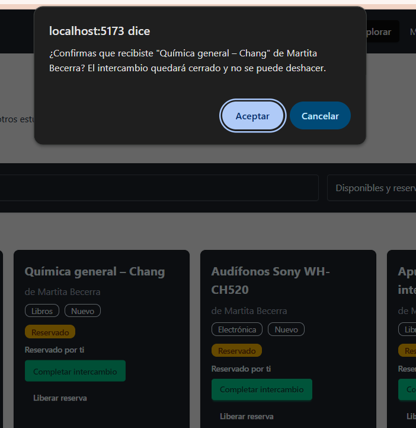

### 2. Confirmación Exitosa en el Dashboard
Tras aceptar la confirmación, se presenta un banner informativo notificando que el intercambio concluyó exitosamente y ofreciendo acceso directo para consultar las publicaciones intercambiadas.

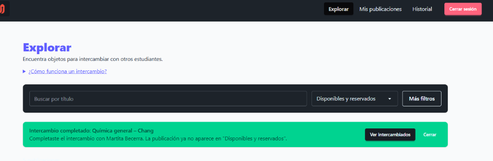

### 3. Listado con Filtro de Intercambiados
Al filtrar las publicaciones por estado **Intercambiado**, el artículo aparece marcado como completado y ya no está disponible para reserva.

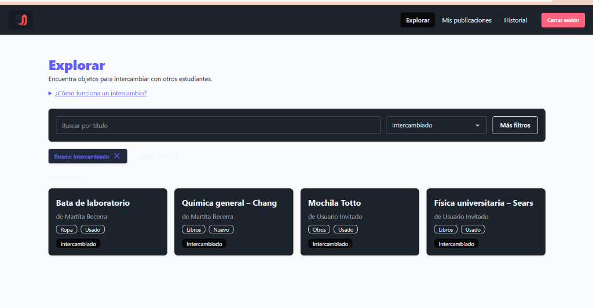

### 4. Código que procesa la Confirmación

#### Frontend (`frontend/src/views/DashboardView.vue`):
```javascript
async function handleComplete(post) {
    const message = `¿Confirmas que recibiste "${post.title}" de ${post.owner?.name}? ` +
        "El intercambio quedará cerrado y no se puede deshacer.";
    if (!confirm(message)) return;
    actionError.value = null;
    try {
        await postsStore.completeExchange(post.id);
        completedPost.value = { title: post.title, owner: post.owner?.name };
    } catch (err) {
        actionError.value = { title: `No se pudo completar el intercambio de "${post.title}"`, text: err.message };
        if (err.network) return;
    }
    loadPosts();
}
```

#### Backend Controller (`backend/src/controllers/post.controller.js`):
```javascript
exports.complete = async (req, res) => {
    const post = await Post.findByPk(req.params.id);
    if (!post) throw new HttpError(404, "Publicación no encontrada.");

    const error = getCompleteError(post, req.user.id);
    if (error) {
        const status = post.state === "reservado" ? 403 : 400;
        throw new HttpError(status, error);
    }

    await post.update({ state: "intercambiado" });

    // Registro de actividad para el receptor
    await Activity.create({
        userId: post.reservedById,
        type: "intercambio_completado",
        role: "receptor",
        postId: post.id,
        postTitle: post.title,
        otherUserName: await getUserName(post.userId),
    });
    // Registro de actividad para el entregador
    await Activity.create({
        userId: post.userId,
        type: "intercambio_completado",
        role: "entregador",
        postId: post.id,
        postTitle: post.title,
        otherUserName: await getUserName(post.reservedById),
    });

    res.json({
        message: "Intercambio completado.",
        post,
    });
};
```

---

## Historial de Actividades (`/history`)

La sección de historial permite al usuario consultar y filtrar cronológicamente todas las acciones realizadas dentro de la plataforma (reservas, cancelaciones e intercambios completados).

### 1. Pestaña "Todos"
Muestra el registro completo de actividades del usuario ordenadas por fecha reciente.

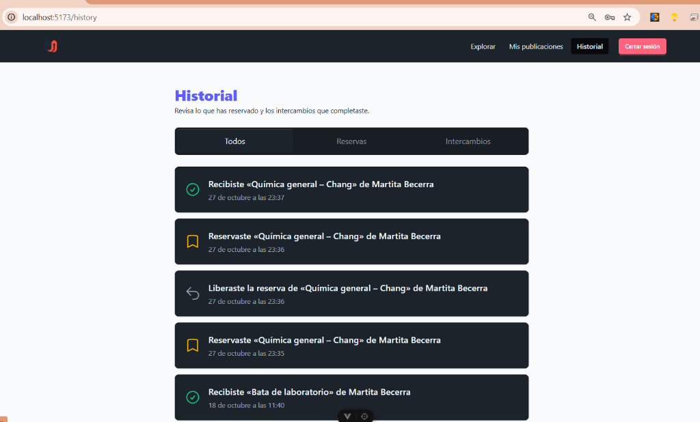

### 2. Pestaña "Reservas"
Filtra específicamente las actividades relacionadas con reservas y liberaciones de reservas.

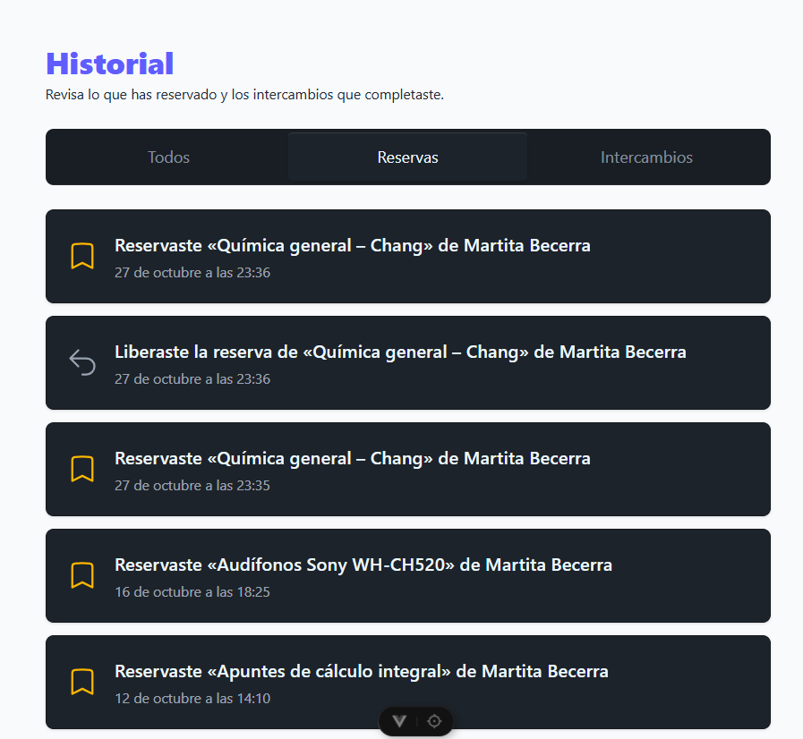

### 3. Pestaña "Intercambios"
Filtra únicamente los intercambios confirmados y cerrados satisfactoriamente.

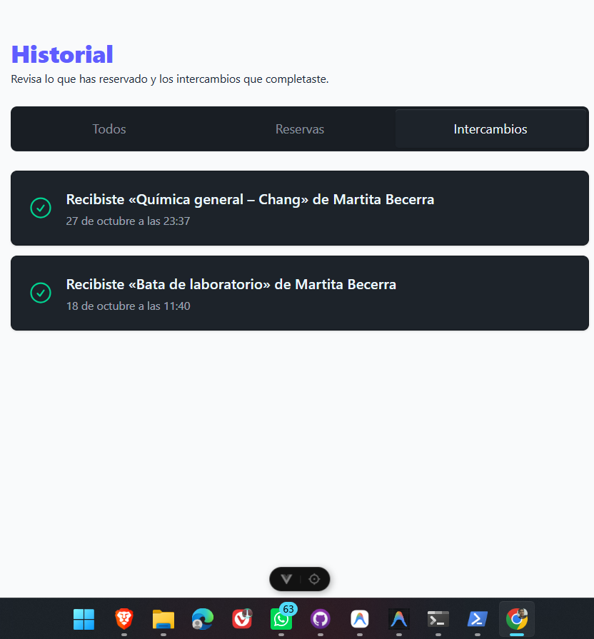

### 4. Código del Historial

#### Frontend (`frontend/src/views/HistoryView.vue`):
```javascript
function describe(activity) {
    const title = `«${activity.postTitle}»`;
    if (activity.type === "reservado") {
        return `Reservaste ${title} de ${activity.otherUserName}`;
    }
    if (activity.type === "reserva_liberada") {
        return `Liberaste la reserva de ${title} de ${activity.otherUserName}`;
    }
    if (activity.role === "receptor") {
        return `Recibiste ${title} de ${activity.otherUserName}`;
    }
    return `Entregaste ${title} a ${activity.otherUserName}`;
}
```

#### Backend Controller (`backend/src/controllers/activity.controller.js`):
```javascript
exports.list = async (req, res) => {
    const where = { userId: req.user.id };
    if (req.query.type === "reservas") {
        where.type = { [Op.in]: ["reservado", "reserva_liberada"] };
    }
    if (req.query.type === "intercambios") {
        where.type = "intercambio_completado";
    }

    const activities = await Activity.findAll({
        where,
        order: [["createdAt", "DESC"]],
    });
    res.json({ activities });
};
```

---

## Gestión de Publicaciones Propias (`/posts`)

En esta sección el usuario puede gestionar los artículos que ha puesto a disposición para trueque, crear nuevas publicaciones mediante un formulario modal, editar información o eliminarlas, así como monitorear el estado de cada una.

### 1. Interfaz de "Mis publicaciones"
Tabla con las publicaciones del usuario (título, categoría, condición, estado y acciones contextuales). Si el objeto aún no ha sido reservado por otro estudiante, el sistema informa: *"Para completar el intercambio, otro estudiante debe reservarlo primero"*.

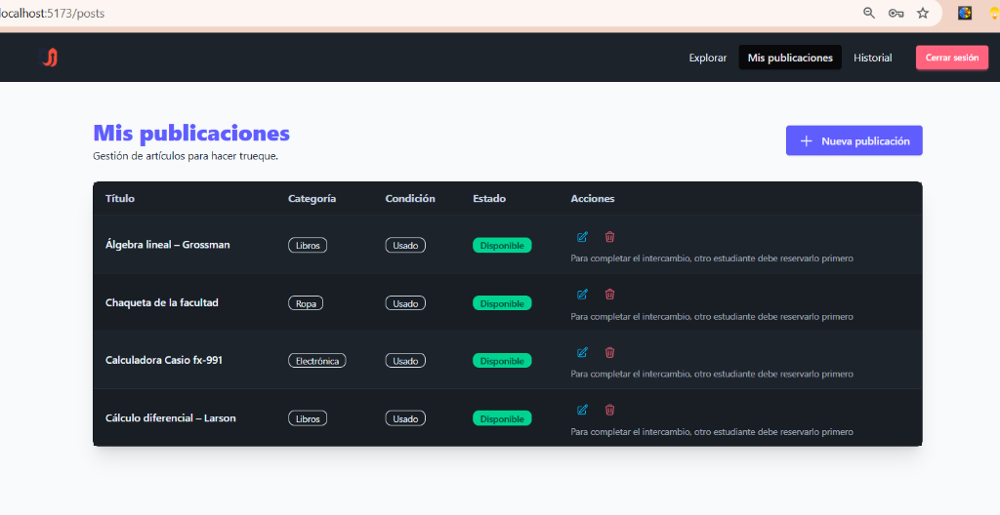

### 2. Código de Gestión de Publicaciones

#### Frontend (`frontend/src/views/UserPostsView.vue`):
```javascript
const { posts, loading, error } = storeToRefs(postsStore);

function openCreateModal() {
    selectedPost.value = null;
    isModalOpen.value = true;
}

function openEditModal(post) {
    selectedPost.value = { ...post };
    isModalOpen.value = true;
}

async function handleDelete(id) {
    if (!confirm("¿Deseas eliminar esta publicación?")) return;
    actionError.value = "";
    try {
        await postsStore.deletePost(id);
    } catch (err) {
        showActionError(err);
    }
}
```

#### Backend Controller (`backend/src/controllers/post.controller.js`):
```javascript
exports.list = async (req, res) => {
    const posts = await Post.findAll({
        where: { userId: req.user.id },
        include: [{ model: User, as: "reservedBy", attributes: ["id", "name"] }],
        order: [["publishedAt", "DESC"]],
    });
    res.json({ posts });
};
```

---

## Estructura del Código en el Entorno de Desarrollo (IDE)

Vista del entorno con la vista [`DashboardView.vue`](file:///c:/Users/contr/Documents/Repositorios de Git/2ndProject/frontend/src/views/DashboardView.vue) abierta y la terminal del proyecto:

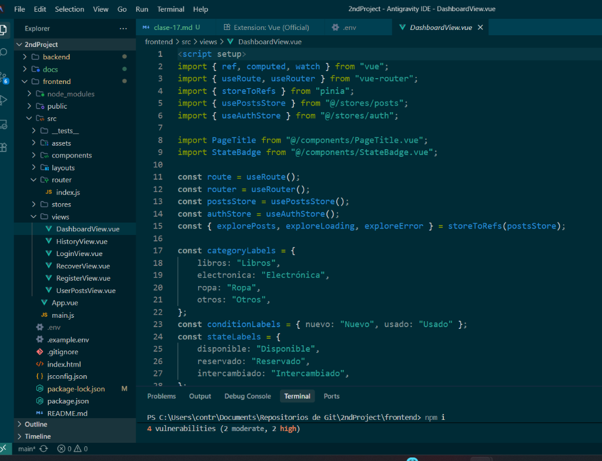

---

## Impacto: Sistema de Ofertas de Trueque (Propuesta de Cambio)

### 1. Flujo de Estados

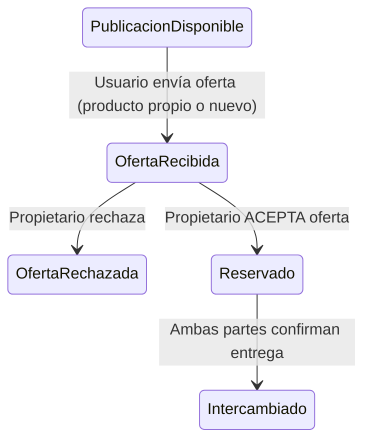

---

### 2. Cambios en la UI y Cards (Señalados sobre las Capturas)

#### A. Card en el Feed Principal (`DashboardView.vue`)


* **Elemento a cambiar:** Botón morado `Reservar`.
* **Sustitución:**
  1. Reemplazar por botón **`[Hacer oferta]`**.
  2. Agregar badge de conteo: **`X ofertas activas`**.
  3. Al pulsar: Desplegar modal con selector de 2 vías:
     - *Elegir un producto publicado de mi inventario.*
     - *Publicar un nuevo producto para ofertar en el acto.*

#### B. Tabla en "Mis Publicaciones" (`UserPostsView.vue`)


* **Elemento a cambiar:** Columna **Acciones** y el texto *"Para completar el intercambio, otro estudiante debe reservarlo primero"*.
* **Sustitución:**
  1. Añadir botón interactivo: **`[Ver ofertas recibidas (N)]`**.
  2. Desplegable / Modal con las ofertas recibidas (datos del ofertante y del producto ofrecido) con opciones **`[Aceptar]`** y **`[Rechazar]`**.
  3. Al pulsar `[Aceptar]`: El estado del producto pasa de inmediato a **`Reservado`** y cancela las ofertas restantes.

#### C. Card en Estado Reservado


* **Elemento a cambiar:** La tarjeta en estado `Reservado`.
* **Sustitución:** Mostrar explícitamente el **producto aceptado a cambio** (enlace bidireccional Producto A $\leftrightarrow$ Producto B) antes de habilitar el botón `[Completar intercambio]`.

---

### 3. Impacto en el Código (Resumen Técnico)

| Capa | Archivo / Componente | Modificación Concreta |
| :--- | :--- | :--- |
| **Base de Datos** | `backend/src/models/Offer.js` | Nueva tabla `Offers` (`id`, `targetPostId`, `offeredPostId`, `proposerId`, `status: pendiente \| aceptada \| rechazada`). |
| **Backend API** | `backend/src/routes/offer.routes.js` | Endpoints: `POST /posts/:id/offers` (ofertar), `GET /posts/:id/offers` (listar ofertas recibidas), `PATCH /offers/:id/accept` (aceptar y reservar ambos). |
| **Frontend Cards** | `frontend/src/views/DashboardView.vue` | Reemplazar acción directa `Reservar` por modal de oferta (`TradeOfferModal.vue`). |
| **Frontend Gestión**| `frontend/src/views/UserPostsView.vue` | Desplegable de ofertas recibidas con botones `Aceptar` / `Rechazar`. |
| **Frontend Store** | `frontend/src/stores/offers.js` | Acciones Pinia: `sendOffer()`, `fetchOffers()`, `acceptOffer()`, `rejectOffer()`. |


