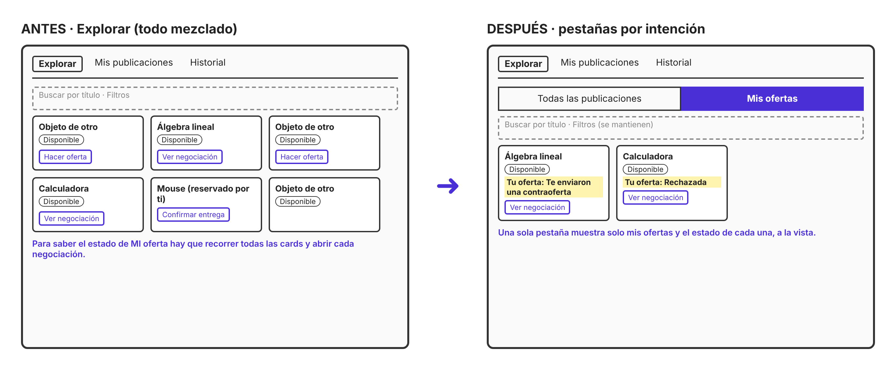
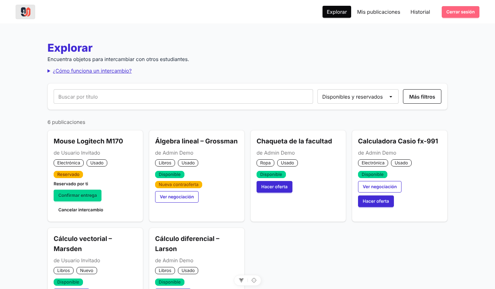
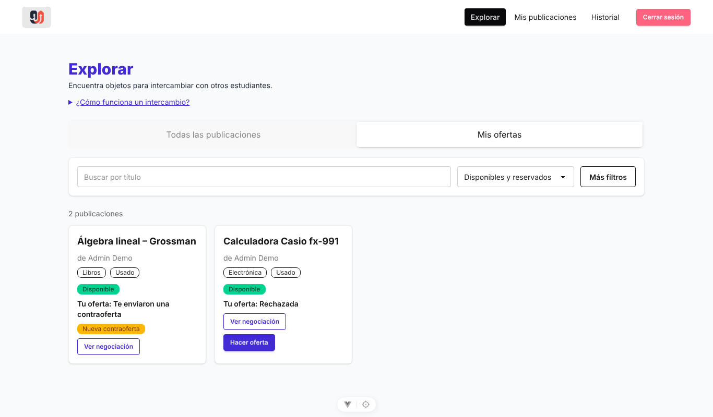

# Evidencias - Clase 20

## Integrantes

- Contreras Garzon Jon Natanael
- Flores Veizaga Eudenia Gandira

## Problema

La tarea «Encuentra el estado de la oferta que enviaste» era difícil de encontrar: había que recorrer todas las publicaciones de Explorar y abrir `Ver negociación` en cada una para saber si la oferta fue aceptada, rechazada o contraofertada.

## Dibujo de la propuesta

Se agregan dos pestañas en Explorar: **Todas las publicaciones** y **Mis ofertas**. En «Mis ofertas» cada card muestra «Tu oferta: <estado>» y el botón `Ver negociación`.

## Motivo

Se agrupó por propósito y rol: lo que yo envié queda separado del catálogo general. El nombre «Mis ofertas» anticipa el contenido y la pestaña está donde la persona hizo la oferta.

## Capturas antes / después

| Antes                                 | Después                                      |
| ------------------------------------- | -------------------------------------------- |
|  |  |

## Resultado de la prueba

- **Probó:** Contreras Garzón Job Natanael
- **Tarea:** «Encuentra el estado de la oferta que enviaste»
- **Resultado:** (sin ayuda / con ayuda / no la encontró)
- **Dónde dudó:** (completar)
- **Qué se ajustó después:** (completar)

## Commit

(pegar enlace al commit)
