# Evidencia de la Tarea 7 — Mejora por Feedback y Completar/Cancelar Intercambio Acordado (`Trueque U`)

---

## 1. Enlace al Feedback Recibido y Resumen de losDos Commits

- **Feedback recibido (evaluación cruzada):** [https://github.com/ihc-team/Pre_estudiantil/commit/aa219cd3721ed0cd81ddfb1bd6f49654b89ab55c](https://github.com/ihc-team/Pre_estudiantil/commit/aa219cd3721ed0cd81ddfb1bd6f49654b89ab55c)
- **Detalle del análisis en el repositorio:** [`docs/feedback-recibido-tarea-7.md`](../feedback-recibido-tarea-7.md)

| # | Tipo | Mensaje de Commit | Descripción |
| :--- | :--- | :--- | :--- |
| **Commit 1** | **Mejora por feedback** | [`fix: mostrar hilo de ofertas y contraofertas al ofertante`](https://github.com/Job-Natanael-Contreras-Garzon/2ndProject/commit/1f74e41) (`1f74e41`) | Corrige el hallazgo de que la contraoferta solo se veía en el historial. Incorpora el modelo `OfferMessage` y el modal tipo chat **«Ver negociación»** en cada tarjeta de publicación (para el ofertante) y en las ofertas recibidas (para el dueño), permitiendo ver todo el hilo y responder. |
| **Commit 2** | **Funcionalidad del caso (`Trueque U`)** | `feat: completar o cancelar intercambio acordado con doble confirmacion y motivo` | Implementa el requisito de la diapositiva: aceptar una oferta cierra la negociación; cada parte confirma la entrega y **solo con ambas confirmaciones** pasa a *completado*; antes de completarse, cualquiera puede **cancelar con motivo** (con selector de respuesta guía por defecto), conservando el historial y devolviendo la publicación a *disponible* sin reactivar ofertas anteriores. |

---

## 2. Evidencia Breve de Cada Resultado

### Resultado 1 — Mejora por Feedback: Hilo de Negociación (Ofertas y Contraofertas)

- **Problema reportado en el feedback:** *"La contraoferta solo se ve en el historial. No aparece en «Mis publicaciones» ni en las publicaciones."* Quien ofertaba no tenía forma de ver la oferta que envió junto con la contraoferta recibida ni responder desde la publicación.
- **Solución implementada:**
  - En **Explorar (`/dashboard`)**, cada tarjeta donde el usuario tiene una oferta muestra la insignia **`Nueva contraoferta`** y el botón **`Ver negociación`**.
  - Al abrir **`Ver negociación`**, se despliega un modal tipo chat (`OfferThread.vue`) con todos los mensajes ordenados cronológicamente (oferta inicial, contraoferta del dueño y respuestas) y un formulario para que el ofertante responda.
  - En **Mis publicaciones (`/posts`)**, el dueño también dispone del botón **`Ver negociación`** dentro de las ofertas recibidas.

| Vista en la tarjeta de la publicación (`Nueva contraoferta` + `Ver negociación`) | Modal tipo chat del ofertante con la oferta, contraoferta y formulario de respuesta |
| :---: | :---: |
| 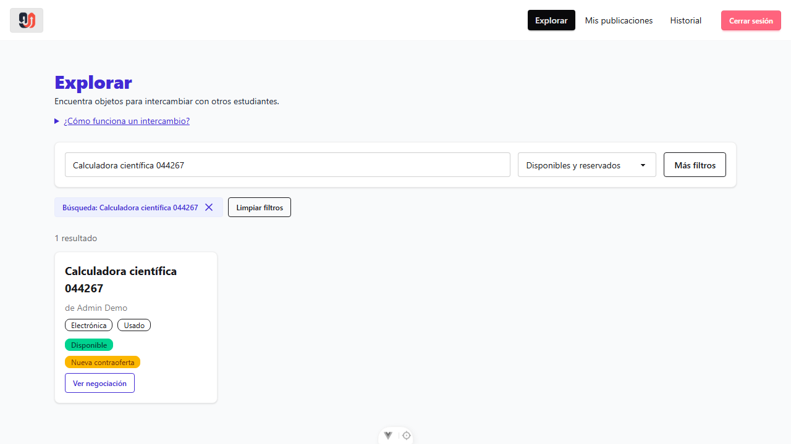 | 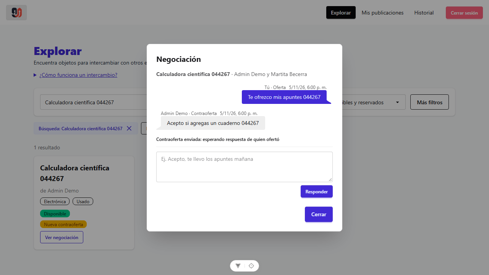 |

| Respuesta enviada por el ofertante en el hilo | Hilo completo visto por el dueño en «Mis publicaciones» |
| :---: | :---: |
| 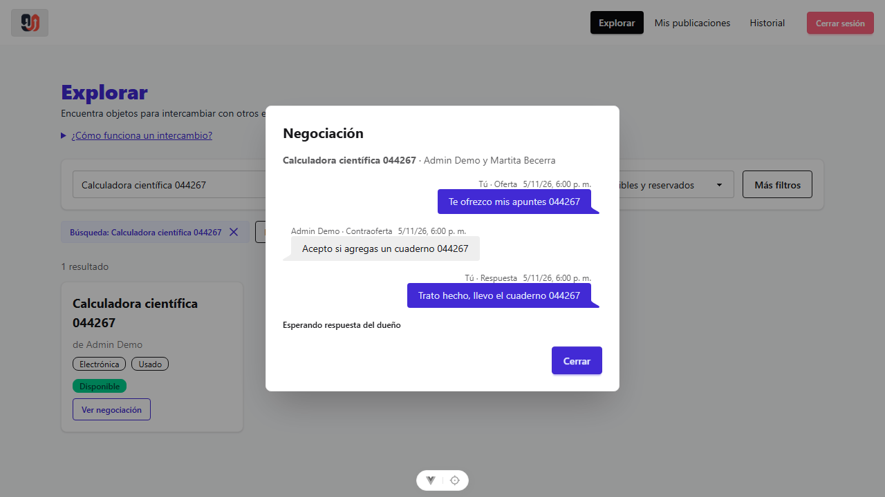 | 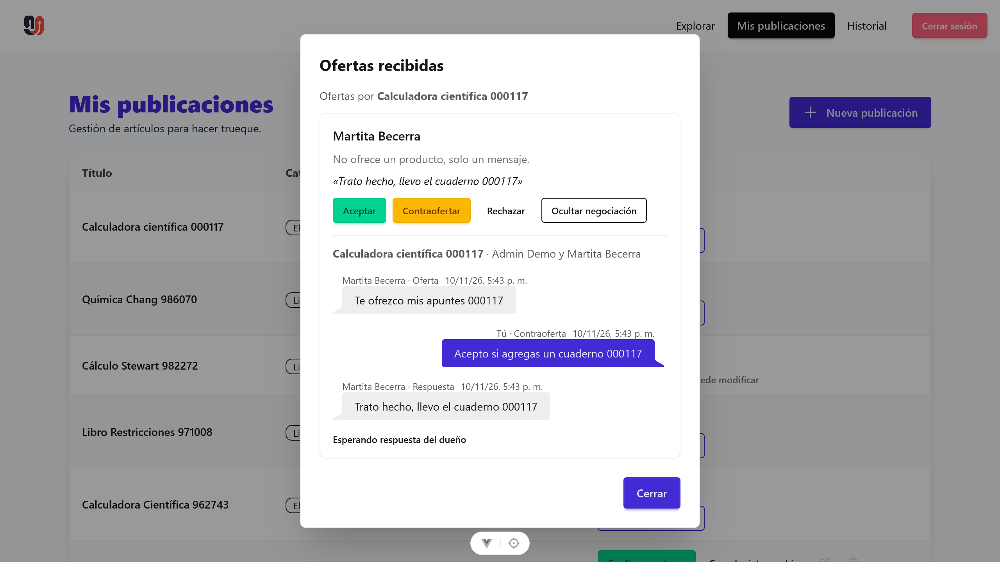 |

---

### Resultado 2 — Funcionalidad del Caso (Parte A): Doble Confirmación de Entrega

- **Requisito:** *"Aceptar una oferta cierra la negociación y bloquea aceptar otras para el mismo objeto. Cada parte confirma la entrega; solo con ambas confirmaciones pasa a completado. Primera confirmación no completa; segunda sí."*
- **Evidencia:**
  1. **Primera confirmación (dueño en `/posts`):** Al pulsar **`Confirmar entrega`**, la publicación **se mantiene en estado `Reservado`** y muestra el aviso *"Confirmaste la entrega. Esperando confirmación de Martita Becerra."*
  2. **Segunda confirmación (receptor en `/dashboard`):** La tarjeta indica que el dueño ya confirmó. Cuando el receptor pulsa **`Confirmar entrega`**, recién el intercambio pasa a **`Intercambiado`**.
  3. **Historial (`/history`):** Registra cada confirmación individual y el intercambio completado.

| 1. Primera confirmación (sigue `Reservado`, esperando a la otra parte) | 2. Segunda confirmación (completa el intercambio) | 3. Registro en el Historial |
| :---: | :---: | :---: |
| 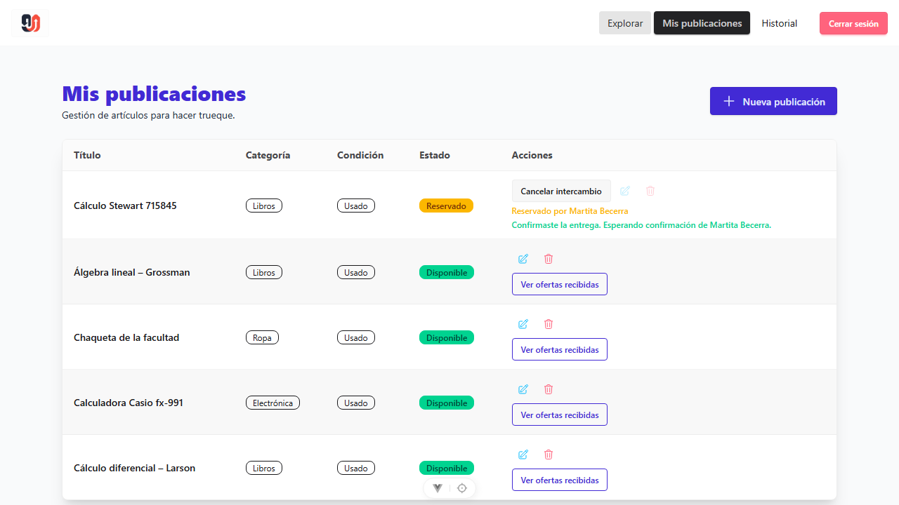 | 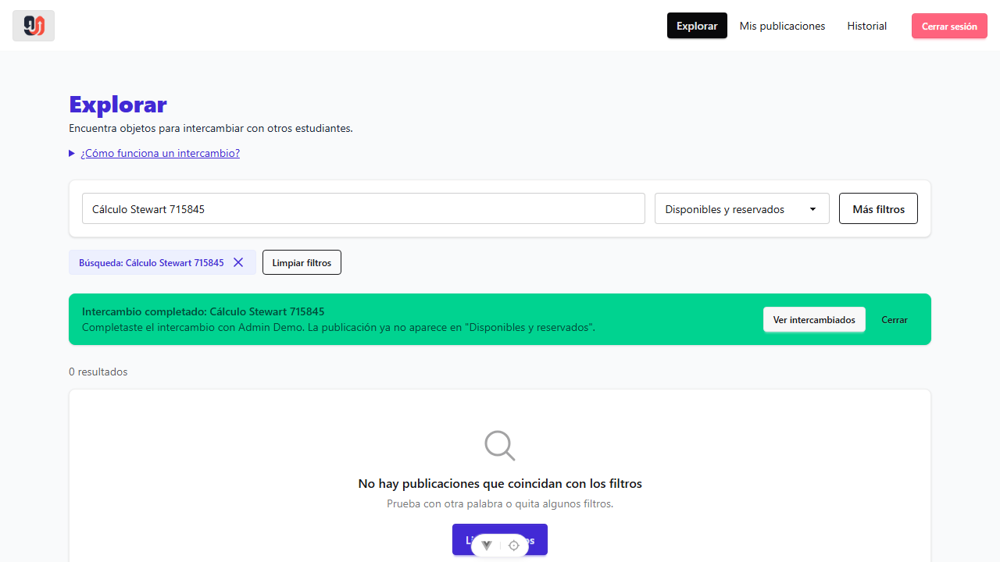 | 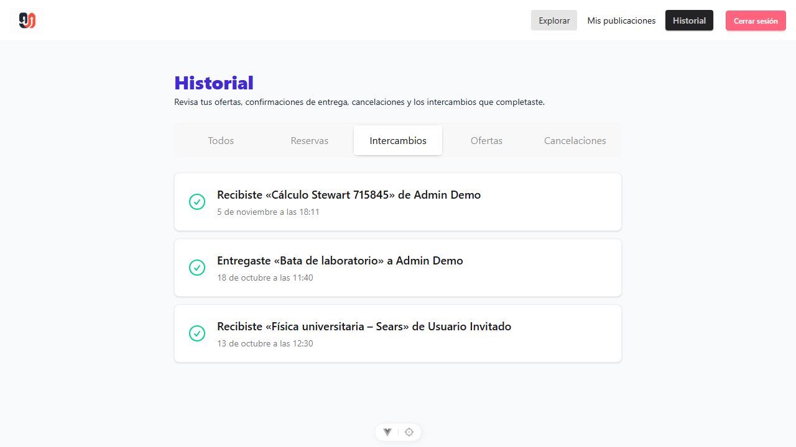 |

---

### Resultado 3 — Funcionalidad del Caso (Parte B): Cancelar Intercambio con Motivo

- **Requisito:** *"Antes de completarse, cualquiera puede cancelar con motivo: se conserva el historial y la publicación vuelve a estar disponible, sin reactivar ofertas anteriores."*
- **Evidencia:**
  1. **Formulario con respuesta guía por defecto (`CancelExchangeForm.vue`):** Incluye un selector de motivos frecuentes que rellena el campo **`Descripción del motivo`** como guía editable, y valida que no se envíe vacío.
  2. **Liberación sin reactivar ofertas:** Tras confirmar la cancelación, la publicación vuelve a estado **`Disponible`**, la oferta aceptada pasa a `cancelada` y las ofertas anteriores siguen `rechazada` (no se reactivan).
  3. **Historial mejorado (`/history`):** Incorpora la pestaña **`Cancelaciones`** y muestra el motivo tanto en la lista como en el modal de detalle para ambos participantes.

| 1. Modal de cancelación con respuesta guía por defecto | 2. Validación cuando falta el motivo |
| :---: | :---: |
| 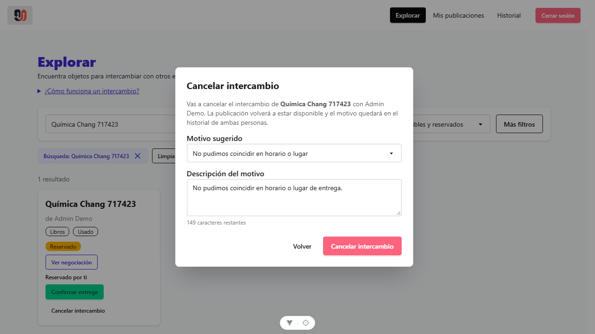 | 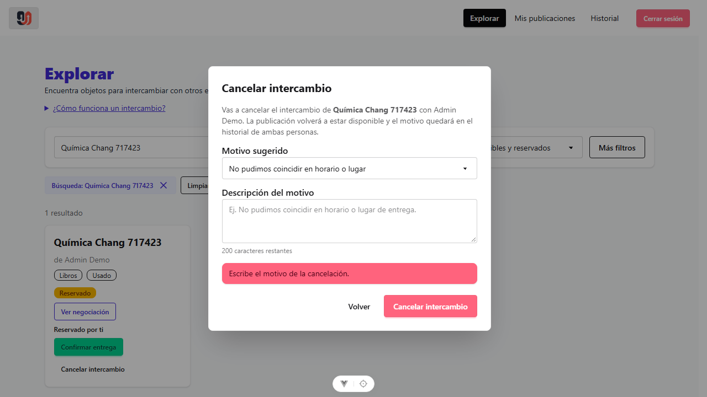 |

| 3. Publicación liberada nuevamente como `Disponible` | 4. Historial de cancelaciones con el motivo conservado |
| :---: | :---: |
| 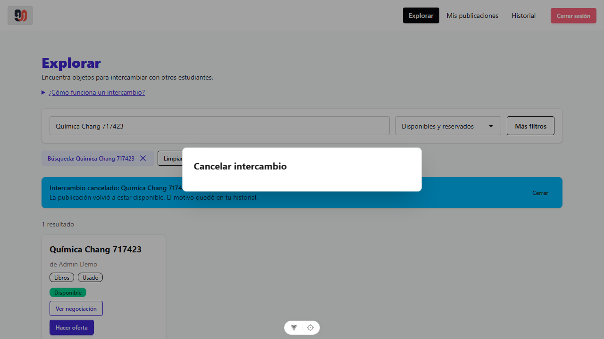 | 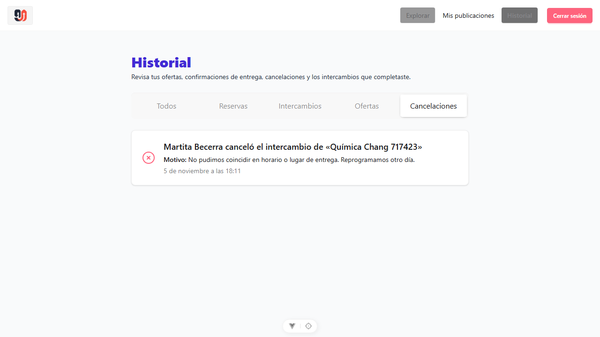 |

---

## 3. Pruebas Automatizadas (Playwright E2E y Jest Backend)

- **Playwright E2E:**
  - [`tests/hilo-negociacion.spec.js`](../../tests/hilo-negociacion.spec.js): verifica que el ofertante visualiza su oferta inicial y la contraoferta recibida desde la tarjeta de la publicación, responde en el hilo y el dueño ve la conversación actualizada.
  - [`tests/confirmar-entrega.spec.js`](../../tests/confirmar-entrega.spec.js):
    - *Caso 1:* verifica que la primera confirmación mantiene la publicación en `reservado` y la segunda confirmación la pasa a `intercambiado`.
    - *Caso 2:* verifica el selector con motivo guía, el bloqueo sin motivo, la vuelta a `disponible` sin ofertas pendientes reactivadas y la conservación del motivo en el historial de ambos usuarios.

```text
Running 7 tests using 1 worker
  ✓ [chromium] › tests/confirmar-entrega.spec.js › el intercambio solo se completa cuando confirman las dos partes
  ✓ [chromium] › tests/confirmar-entrega.spec.js › cancelar exige un motivo, devuelve la publicación a disponible y queda en el historial
  ✓ [chromium] › tests/contraofertar.spec.js › revisar ofertas recibidas, contraofertar y verificar en el historial de ambos
  ✓ [chromium] › tests/example.spec.js › has title
  ✓ [chromium] › tests/example.spec.js › get started link
  ✓ [chromium] › tests/hilo-negociacion.spec.js › el ofertante ve su oferta y la contraoferta en un hilo y puede responder
  ✓ [chromium] › tests/publicar-objeto.spec.js › ana publica un objeto
  7 passed (13.2s)
```

- **Jest Backend (`8 test suites, 81 passed`):**
  - [`backend/tests/offer.test.js`](../../backend/tests/offer.test.js): casos 11 a 15 para el hilo de negociación y respuestas.
  - [`backend/tests/exchange.test.js`](../../backend/tests/exchange.test.js): 12 pruebas unitarias/integración de doble confirmación, bloqueo de doble confirmación por la misma parte, rechazo a terceros, cancelación con motivo, conservación del historial y no reactivación de ofertas anteriores.
  - [`backend/tests/postRules.test.js`](../../backend/tests/postRules.test.js): reglas `getConfirmError` y `getCancelError`.
