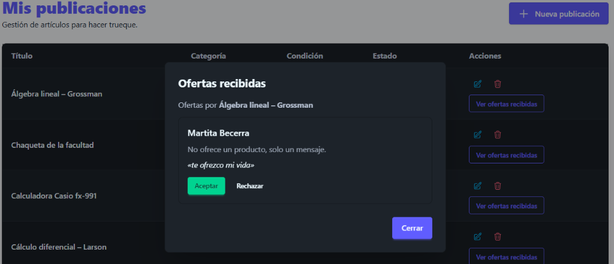
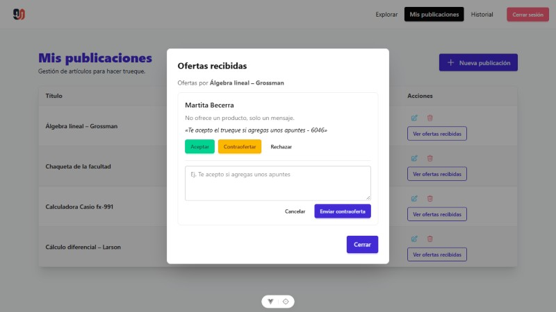
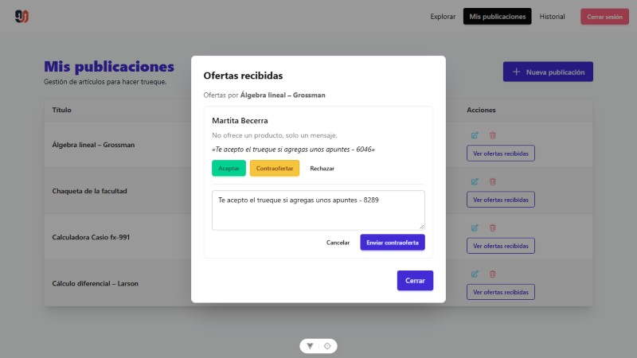
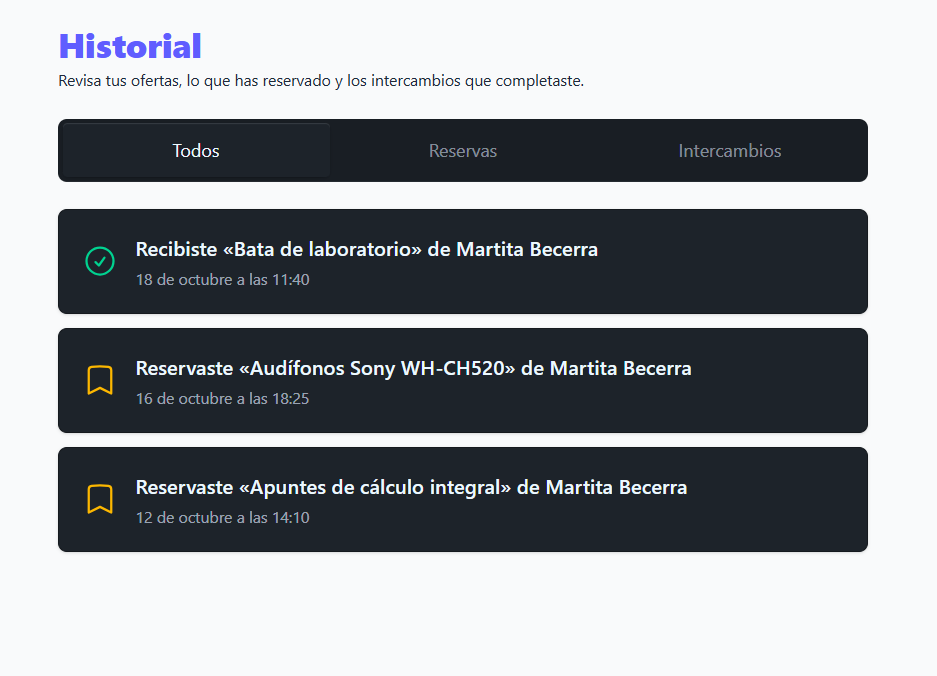
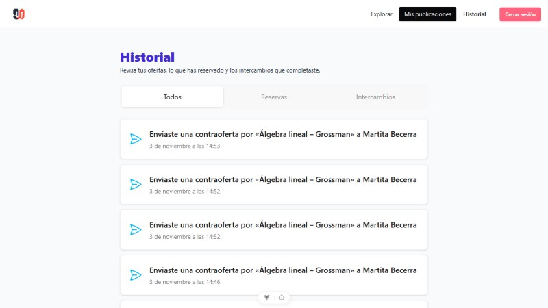

# Evidencias - Tarea 6: Suite de Pruebas y Flujo de Contraofertas (Antes y Después)

## 1. Objetivo del Flujo

Implementar y verificar mediante pruebas automatizadas End-to-End (**Playwright**) y pruebas de integración (**Jest**) el flujo completo de **Contraoferta** en **Trueque U**:

1. **Iniciar sesión** como dueño de una publicación (`Admin Demo`).
2. Navegar a **Mis publicaciones** (`/posts`) y abrir **Ver ofertas recibidas** sobre un artículo con ofertas activas (*Álgebra lineal – Grossman*).
3. Realizar una **Contraoferta** a la oferta enviada por otro estudiante (`Martita Becerra`).
4. Registrar el evento de contraoferta de forma atómica en el **Historial** (`/history`) de **ambos usuarios** (quien envía la contraoferta y quien la recibe).
5. Verificar en la vista de **Historial** de ambos usuarios que la contraoferta aparece registrada correctamente.

---

## 2. Matriz Comparativa de la Suite: Antes vs. Después (Flujo de Contraofertas)

| # | Etapa / Componente del Flujo | Estado ANTES (Sin Contraofertas) | Estado DESPUÉS (Con Flujo de Contraofertas) | Evidencia Visual (Antes vs. Después) |
| :-: | :--- | :--- | :--- | :--- |
| **1** | **Modal de Ofertas Recibidas** (`OfferList.vue` en `/posts`) | El dueño de la publicación solo disponía de dos acciones rígidas: **Aceptar** o **Rechazar** la oferta de `Martita Becerra`. No era posible proponer una condición intermedia. | Se incorpora el botón **`Contraofertar`** junto a *Aceptar* y *Rechazar*, permitiendo negociar sobre la oferta sin cerrarla ni descartarla. | **Antes:**   **Después:**  |
| **2** | **Envío de la Contraoferta** (`OfferList.vue` → `PATCH /api/offers/:id/counter`) | No existía formulario de respuesta ni endpoint en el backend para registrar un mensaje de contraoferta o actualizar el estado a `"contraoferta"`. | Al pulsar **`Contraofertar`**, se despliega un área de texto validada para redactar la contrapropuesta y el botón **`Enviar contraoferta`**. | **Después (Formulario de contraoferta):**  |
| **3** | **Historial del Dueño que Contraoferta** (`Admin Demo` en `/history`) | En el historial del dueño solo figuraban reservas e intercambios previos; no quedaba constancia de las respuestas o contraofertas enviadas. | Se crea automáticamente el evento `contraoferta_enviada` mostrando: **«Enviaste una contraoferta por «Álgebra lineal – Grossman» a Martita Becerra»**. | **Antes:**   **Después (Historial de Admin Demo):**  |
| **4** | **Historial del Ofertante que Recibe la Contraoferta** (`Martita Becerra` en `/history`) | El estudiante que había hecho la oferta original no recibía ningún evento de contraoferta en su historial de actividad. | En la misma transacción se registra el evento `contraoferta_recibida` para el ofertante: **«Recibiste una contraoferta por «Álgebra lineal – Grossman» de Admin Demo»**. | **Después (Historial de Martita Becerra):**  |
| **5** | **Suite de Pruebas Automatizadas** (`tests/contraofertar.spec.js` y `backend/tests/offer.test.js`) | - **E2E (Playwright):** 1 spec (`publicar-objeto.spec.js`). - **Backend (Jest):** 9 pruebas en `offer.test.js` (solo crear, listar, aceptar y rechazar). | - **E2E (Playwright):** Nueva prueba `contraofertar.spec.js` que recorre login, revisión de oferta, envío de contraoferta y verificación en el historial de ambos usuarios. - **Backend (Jest):** Prueba #10 en `offer.test.js` validando estado `"contraoferta"` y doble registro en `Activity` (59/59 tests en verde). | Ejecución automatizada en Chromium (`1 passed (2.2s)`) y suite Jest (`7 passed, 59 total`). |

---

## 3. Detalle Paso a Paso de las Capturas (Antes y Después)

### 3.1. Revisión de Ofertas Recibidas en "Mis publicaciones" (`/posts`)

- **Antes:** Al abrir el modal **Ofertas recibidas** sobre la publicación *Álgebra lineal – Grossman*, la tarjeta de la oferta de **Martita Becerra** («*te ofrezco mi vida*») únicamente presentaba los botones `Aceptar` y `Rechazar`.

- **Después:** La tarjeta incorpora el botón **`Contraofertar`** y, al pulsarlo, despliega el campo de texto para escribir la contrapropuesta y enviarla mediante **`Enviar contraoferta`**.

---

### 3.2. Registro de la Contraoferta en el Historial de Ambos Usuarios (`/history`)

- **Antes:** El historial de **Admin Demo** solo mostraba los eventos previos de reservas e intercambios completados, sin ningún registro de negociación por contraoferta.

- **Después (Vista de Admin Demo - Dueño que contraoferta):** Tras enviar la contraoferta, el historial registra inmediatamente la acción con el mensaje `Enviaste una contraoferta por «Álgebra lineal – Grossman» a Martita Becerra`.

- **Después (Vista de Martita Becerra - Ofertante que recibe la contraoferta):** Al iniciar sesión con la cuenta de **Martita Becerra** y consultar su historial, aparece registrada la contraparte del evento: `Recibiste una contraoferta por «Álgebra lineal – Grossman» de Admin Demo`.

---

## 4. Resumen Técnico de la Implementación y Pruebas

| Capa | Archivo | Cambio Implementado |
| :--- | :--- | :--- |
| **Modelo de Ofertas** | `backend/src/models/Offer.js` | Se añadió `"contraoferta"` a los estados permitidos (`pendiente`, `aceptada`, `rechazada`, `contraoferta`). |
| **Modelo de Actividad** | `backend/src/models/Activity.js` | Se añadieron los tipos `"contraoferta_enviada"` y `"contraoferta_recibida"` para registrar la acción en el historial de ambos participantes. |
| **Reglas de Negocio** | `backend/src/rules/offerRules.js` | Se agregó `getCounterError()` validando que solo el dueño de una publicación disponible pueda contraofertar. |
| **Controlador y Rutas** | `backend/src/controllers/offer.controller.js` `backend/src/routes/offer.routes.js` | Nuevo endpoint `PATCH /api/offers/:id/counter` que actualiza la oferta y crea en transacción los dos registros en `Activity` (dueño y ofertante). |
| **Interfaz y Store** | `frontend/src/components/OfferList.vue` `frontend/src/views/HistoryView.vue` `frontend/src/stores/offers.js` | Acción `counterOffer()`, formulario desplegable de contraoferta en el modal de ofertas recibidas y textos descriptivos en `HistoryView.vue`. |
| **Prueba E2E Playwright** | `tests/contraofertar.spec.js` | Prueba E2E automatizada que ejecuta el flujo completo de contraoferta y comprueba su aparición en el historial tanto de `Admin Demo` como de `Martita Becerra`. |
| **Prueba Unitaria Backend** | `backend/tests/offer.test.js` | Caso de prueba #10: *"contraofertar actualiza la oferta y registra la actividad en el historial de ambos"*. |
