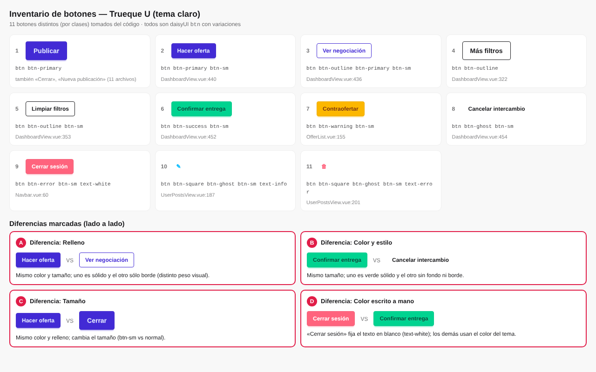

# Clase 23 · Inventario y tokens

Integrantes: Job Natanael Contreras Garzon y Eudenia Flores Gandira
Modalidad: con IA

## 1. Inventario
Captura de los botones distintos de la app (11 combinaciones de clases daisyUI), lado a lado, con las diferencias marcadas en rojo:

Diferencias marcadas (hay 4, se pedían al menos 2):
- **A · Relleno:** `Hacer oferta` (`btn-primary btn-sm`, sólido) vs `Ver negociación` (`btn-outline btn-primary btn-sm`, sólo borde). Mismo color y tamaño, distinto peso visual.
- **B · Color y estilo:** `Confirmar entrega` (`btn-success btn-sm`, verde sólido) vs `Cancelar intercambio` (`btn-ghost btn-sm`, sin fondo ni borde).
- **C · Tamaño:** `Hacer oferta` (`btn-sm`) vs `Cerrar` (tamaño normal), ambos `btn-primary`.
- **D · Color escrito a mano:** `Cerrar sesión` (`btn-error btn-sm text-white`) fija el texto en blanco; los demás botones usan el color del tema.

Mismo inventario en tema oscuro: [clase-23-inventario-oscuro.png](clase-23-inventario-oscuro.png).

## 2. Tokens
En el proyecto no hay CSS propio: los tokens ya existen como variables de daisyUI 5 (`--color-primary`, etc.) y cambian solos entre el tema claro y el oscuro. Se nombran aquí por uso:

| Nombre (por uso) | Variable daisyUI | Valor claro | Valor oscuro | Dónde se usa |
|---|---|---|---|---|
| `color-accion` | `--color-primary` | `#422ad5` | `#605dff` | `btn-primary` (22 botones: Publicar, Hacer oferta, Cerrar…), `text-primary` (13, títulos y enlaces) |
| `color-texto` | `--color-base-content` | `#18181b` | `#ecf9ff` | `text-base-content/70` y similares (58 usos: textos secundarios, etiquetas) |
| `color-fondo` | `--color-base-100` | `#ffffff` | `#1d232a` | `bg-base-100` (16 usos: tarjetas, paneles, modales) |
| `color-error` | `--color-error` | `#ff637d` | `#ff637d` | `alert-error` (17 mensajes de error de formularios), `text-error` (3), `btn-error` (Cerrar sesión) |
| `radio-control` | `--radius-field` | `0.25rem` | `0.25rem` | esquinas de todos los `btn`, `input`, `select` y `textarea` |

Los valores salen de `node_modules/daisyui/theme/light.css` y `dark.css` (daisyUI 5.8.1, en `oklch`; los hex son su conversión). `color-error` y `radio-control` no cambian entre temas.

## 3. Colores fijos
- **Pantalla revisada:** Explorar (`frontend/src/views/DashboardView.vue`) junto con los componentes que dibuja: `Navbar.vue`, `PageTitle.vue`, `StateBadge.vue`, `Modal.vue`, `OfferList.vue`, `OfferForm.vue` y `CancelExchangeForm.vue`.
- **Qué buscaron:** `#hex` (`#[0-9a-fA-F]{3,8}`), `rgb(` / `rgba(`, `Color(0x`, y además `hsl(`, `oklch(`, `style=` en línea y clases de color fijo de Tailwind (`text-white`, `text-gray-800`, `bg-red-500`…).
- **Cuántos encontraron:** **0** con `#hex`, `rgb(` y `Color(0x` (tampoco hay `hsl(`, `oklch(` ni `style=` de color). Sólo **2** colores fijos por nombre de Tailwind: `text-white` en `Navbar.vue:60` y `text-gray-800` en `PageTitle.vue:17`. No se corrigió nada, sólo se contó.
