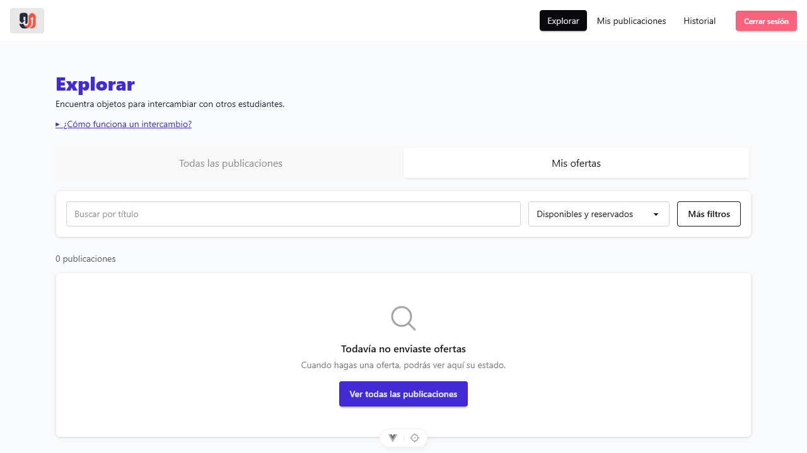
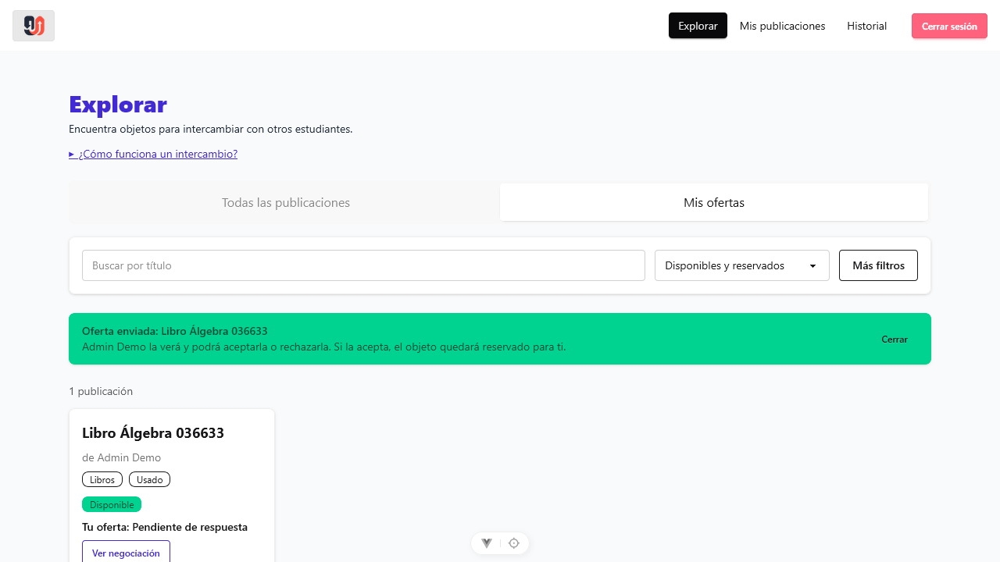
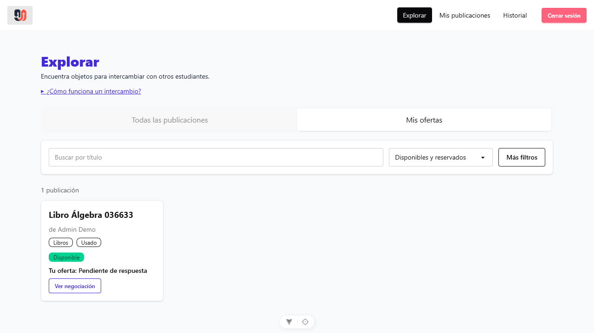
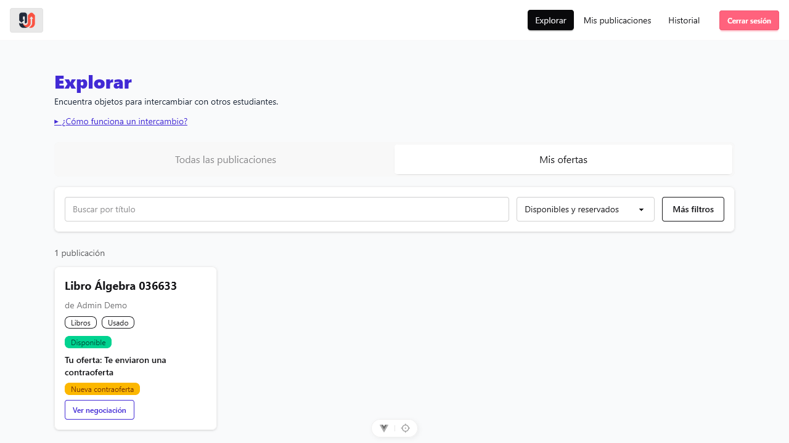
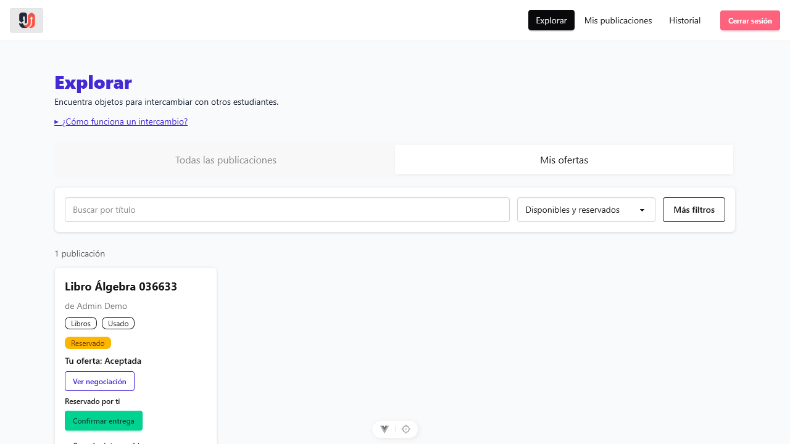
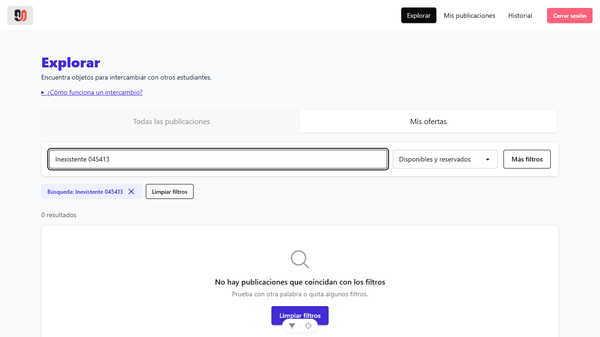

# Evaluación Tarea 8: Pruebas E2E, Análisis de Commits y Verificación de Regresiones

## 1. Integrantes del Grupo

- **Job Natanael Contreras Garzon**
- **Eudenia Flores Gandira**

---

### 2.1 Problema que resuelve
En la versión previa (`9fd5249`), el usuario que enviaba una oferta sobre un artículo debía recorrer minuciosamente todo el catálogo general de publicaciones y abrir individualmente el modal de negociación en cada tarjeta para constatar si el dueño la había aceptado, rechazado o contraofertado. Esto imponía una alta carga cognitiva y pasos repetitivos e ineficientes.

### 2.2 Funcionalidad integrada en el commit `9b28f7c`
La solución técnica introduce una segmentación de vistas mediante pestañas accesibles en el encabezado de Explorar:
1. **Pestaña «Todas las publicaciones» (`vista === 'todas'`):** Muestra el catálogo global de artículos disponibles y reservados de otros usuarios.
2. **Pestaña «Mis ofertas» (`vista === 'mis-ofertas'`):** Filtra y renderiza exclusivamente aquellas publicaciones sobre las cuales el usuario autenticado mantiene una oferta activa o gestionada.
3. **Etiqueta visible del estado de la oferta:** Cada tarjeta de producto desplegada bajo la pestaña «Mis ofertas» muestra de forma directa la leyenda `Tu oferta: <estado>` (`Pendiente de respuesta`, `Te enviaron una contraoferta`, `Aceptada`, `Rechazada`, `Cancelada`), permitiendo un seguimiento sin necesidad de abrir modales de negociación.
4. **Estado vacío interactivo dedicado (*Empty State*):** Al acceder a «Mis ofertas» sin haber realizado ninguna oferta previa, se despliega una interfaz dedicada con el mensaje *«Todavía no enviaste ofertas. Cuando hagas una oferta, podrás ver aquí su estado»* y un botón de acción principal para volver a *«Ver todas las publicaciones»*.

---

## 3. Decisiones Técnicas Clave

1. **Sincronización Bidireccional con la URL (`route.query.vista`):**  
   En lugar de recurrir a un estado local reactivo en memoria (`ref('todas')`), la vista seleccionada se sincroniza directamente con el parámetro de consulta `route.query.vista`. Cuando se selecciona la vista general, el parámetro es eliminado (`delete query.vista`) para conservar URLs limpias; al seleccionar «Mis ofertas», se fija `?vista=mis-ofertas`. Esto garantiza la **persistencia total del estado ante recargas de página (`F5`)**, navegación por historial del navegador (*Atrás/Adelante*) y marcadores o enlaces directos.
2. **Filtrado Reactivo en Cliente sin Carga Adicional al Backend:**  
   Se reutilizaron las consultas existentes a la API REST (`postsStore.fetchExplore()` y `offersStore.fetchMyOffers()`). Mediante la propiedad computada `publicaciones`, el filtrado se realiza en memoria cruzando `explorePosts` con el mapa indexado `offerByPost`. Esto suprimió la necesidad de crear nuevos endpoints en Express o migraciones adicionales en Sequelize, eliminando latencia de red y proveyendo transiciones instantáneas entre pestañas.
3. **Preservación de Vista en Filtros y Búsqueda Facetada:**  
   En la función `applyFilters(values)`, se preserva explícitamente la vista activa (`if (vista.value === 'mis-ofertas') query.vista = 'mis-ofertas'`). De este modo, realizar búsquedas de texto por título (`q`), filtrar por estado (`state`), condición (`condition`) o categoría (`category`) dentro de «Mis ofertas» no restablece accidentalmente la vista al catálogo general.
4. **Mapeo Semántico de Estados Técnicos:**  
   Se definió la constante `estadoOferta` para transformar los valores del modelo (`pendiente`, `contraoferta`, `aceptada`, `rechazada`, `cancelada`) a descripciones claras y orientadas a la experiencia del usuario estudiantil.
5. **Diferenciación de Estados Vacíos (*Empty States*):**  
   Se distinguen claramente tres condiciones en el DOM:
   - Filtros de búsqueda sin coincidencia (*«No hay publicaciones que coincidan con los filtros»* con botón *«Limpiar filtros»*).
   - Pestaña de ofertas sin actividad (*«Todavía no enviaste ofertas»* con botón *«Ver todas las publicaciones»*).
   - Catálogo general sin registros (*«Todavía no hay publicaciones de otros estudiantes»*).

---

## 4. Archivos Afectados Sustantivos

El commit `9b28f7c` afecta de manera **exclusiva y sustantiva** a un único archivo de código en todo el proyecto:

| Archivo | Tipo de Modificación | Líneas | Impacto y Justificación Técnica |
| :--- | :---: | :---: | :--- |
| `frontend/src/views/DashboardView.vue` | Modificado | +51 / -4 | **Único archivo de código sustantivo modificado.** Incorpora las pestañas con accesibilidad ARIA (`role="tablist"`, `role="tab"`), la propiedad computada `vista`, la función `cambiarVista`, la preservación de vista en `applyFilters`, el filtrado reactivo de `publicaciones`, la etiqueta `Tu oferta: <estado>` en tarjeta y el *Empty State* interactivo. |
| `docs/evidencias/clase-20.md` | Nuevo | +38 / -0 | Documentación complementaria del trabajo en clase de IHC (diseño de interacción y justificación de usabilidad). |
| `docs/evidencias/clase-20/*.png` | Nuevos | Binarios (5 archivos) | Capturas de bocetos preliminares y comparativas antes/después para el informe de clase. |

*Nota sobre cambios triviales:* No se modificaron dependencias secundarias, archivos de configuración de build, archivos de backend, modelos de base de datos ni `package.json`.

---

## 5. Comandos Exactos para Ejecución de Pruebas

### 5.1 Pre-requisitos de Entorno
Asegurarse de que los servidores locales se encuentren en ejecución (los puertos predeterminados son 3000 para backend y 5173 para frontend):
```powershell
# Terminal 1 - Backend:
cd backend
npm run dev

# Terminal 2 - Frontend:
cd frontend
npm run dev
```

*(Opcional) Para restablecer la base de datos SQLite a su estado semilla inicial:*
```powershell
cd backend
npm run seed
```

### 5.2 Ejecución por Consola CLI (Modo Headless)

El gestor de paquetes canónico del proyecto es **pnpm** (declarado en `package.json` mediante `devEngines` y `"packageManager": "pnpm@12.16.1"`). 

Para ejecutar la nueva suite de pruebas E2E de la Tarea 8:
```powershell
pnpm exec playwright test tests/mis-ofertas.spec.js --project=chromium --workers=1
```

Alternativa directa mediante el binario local del proyecto:
```powershell
.\node_modules\.bin\playwright.cmd test tests/mis-ofertas.spec.js --project=chromium --workers=1
```

Alternativa con npx (requiere omitir la validación de motores en entornos npm estrictos):
```powershell
npx --no-dev-engines playwright test tests/mis-ofertas.spec.js --project=chromium --workers=1
```

### 5.3 Ejecución con Interfaz Gráfica (`--ui`)

Para abrir el entorno interactivo de Playwright con inspección visual del DOM, árbol de componentes y depuración paso a paso:
```powershell
pnpm exec playwright test --ui
```

O mediante el binario local / npx:
```powershell
.\node_modules\.bin\playwright.cmd test --ui
npx --no-dev-engines playwright test --ui
```

---

## 6. Capturas de Pantalla Automatizadas de las Pruebas E2E

Las siguientes 8 capturas fueron tomadas de manera completamente automatizada durante la ejecución de `tests/mis-ofertas.spec.js` en Playwright, empleando pausas de estabilización de 600 ms para transiciones de TailwindCSS y DaisyUI.

| # | Archivo | Caso de Prueba | Descripción de la Evidencia |
| :-: | :--- | :--- | :--- |
| **01** | `evidencias/01-mis-ofertas-vacio.png` | Happy Path | Visualización del *Empty State* en «Mis ofertas» con el texto *"Todavía no enviaste ofertas"* y el botón *"Ver todas las publicaciones"*. |
| **02** | `evidencias/02-mis-ofertas-pendiente.png` | Happy Path | Tarjeta en «Mis ofertas» mostrando *"Tu oferta: Pendiente de respuesta"* y botón *"Ver negociación"*, aislando la publicación ofertada. |
| **03** | `evidencias/03-mis-ofertas-persistencia-recarga.png` | Happy Path | Verificación de persistencia tras `page.reload()` (F5): la URL conserva `?vista=mis-ofertas` y la tarjeta persiste con su estado. |
| **04** | `evidencias/04-mis-ofertas-contraoferta.png` | Happy Path | Actualización tras contraoferta del dueño: refleja *"Tu oferta: Te enviaron una contraoferta"* y badge *"Nueva contraoferta"*. |
| **05** | `evidencias/05-mis-ofertas-aceptada.png` | Happy Path | Aceptación de la oferta: estado *"Tu oferta: Aceptada"*, reserva *"Reservado por ti"* y botón activo de *"Confirmar entrega"*. |
| **06** | `evidencias/06-restriccion-sin-duplicados.png` | Restricción Clave | Bloqueo de ofertas duplicadas: botón *"Hacer oferta"* oculto y solo disponible *"Ver negociación"* ante oferta activa. |
| **07** | `evidencias/07-restriccion-aislamiento-usuarios.png` | Restricción Clave | Aislamiento entre usuarios: el dueño inicia sesión y comprueba que en su pestaña «Mis ofertas» no aparecen las ofertas recibidas de terceros. |
| **08** | `evidencias/08-restriccion-preservacion-filtros.png` | Restricción Clave | Preservación del parámetro `vista=mis-ofertas` al interactuar con el buscador por texto y validación de *Empty State* de filtro sin resultados. |

### Visualización de Evidencias

#### Captura 01: Estado Vacío de Mis Ofertas (Empty State)


#### Captura 02: Oferta en Estado Pendiente de Respuesta


#### Captura 03: Persistencia de Vista y Datos tras Recarga (F5)


#### Captura 04: Estado con Contraoferta Recibida


#### Captura 05: Oferta Aceptada y Publicación Reservada


#### Captura 06: Restricción de Duplicados (Bloqueo de botón «Hacer oferta»)


#### Captura 07: Restricción de Aislamiento Estricto entre Usuarios


#### Captura 08: Preservación de Vista al Filtrar y Buscar


---

## 7. Resultado Completo de la Suite de Pruebas y Explicación de Pendientes

### 7.1 Backend Unitario / Integración (Jest)
- **Comando:** `cd backend; npm test`
- **Resultado:** **8 suites pasadas, 81 pruebas aprobadas (100% PASS)**.
- **Tiempo de ejecución:** 2.595 s.
- **Conclusión:** Ninguna regresión en la lógica de negocio, reglas de ofertas (`offerRules`), reglas de publicaciones (`postRules`), filtros ni autenticación.

### 7.2 Frontend Unitario (Vitest)
- **Comando:** `cd frontend; npm run test:unit`
- **Resultado:** **1 prueba fallida preexistente (`App.spec.js`)**.
- **Diagnóstico Técnico del Fallo:**
  ```text
  FAIL src/__tests__/App.spec.js > App > mounts renders properly
  AssertionError: expected '' to contain 'You did it!'
  [Vue warn]: Failed to resolve component: RouterView
  ```
- **Explicación Técnica del Pendiente:**  
  La prueba unitaria `App.spec.js` es un artefacto residual generado por la plantilla base de Vite (`create-vue`). Dicha plantilla asumía la existencia del componente inicial de bienvenida `HelloWorld.vue` con la frase *"You did it!"*. Al estructurar la aplicación real con Vue Router, el archivo `frontend/src/App.vue` pasó a contener exclusivamente `<template><RouterView /></template>`. Como la prueba unitaria invoca `mount(App)` sin inyectar un plugin o mock de enrutador, el componente renderiza una cadena vacía `''`. Este pendiente es **100% preexistente e inherente al andamiaje inicial del repositorio**, sin relación alguna con el commit `9b28f7c`.

### 7.3 Playwright E2E: Ejecución Paralela vs Ejecución Serial Canónica

#### Comportamiento en Modo Paralelo por Defecto (`--workers=6` o sin flag)
- **Comando:** `pnpm exec playwright test --project=chromium`
- **Resultado:** 1 fallo en `tests/contraofertar.spec.js:53` por colisión de selectores.
  ```text
  Error: strict mode violation: getByText('Martita Becerra') resolved to 2 elements:
      1) <span class="text-xs text-warning font-medium"> Reservado por Martita Becerra</span>
      2) <p class="font-semibold">Martita Becerra</p>
  ```
- **Explicación Técnica del Fallo Concurrente:**  
  El backend utiliza una base de datos física compartida en disco (`backend/database.sqlite`). Cuando múltiples workers de Playwright se ejecutan concurrentemente, la prueba `confirmar-entrega.spec.js` reserva publicaciones a nombre de Martita Becerra bajo el usuario Admin Demo. Cuando `contraofertar.spec.js` abre la lista de publicaciones del Admin Demo, el selector `getByText('Martita Becerra')` encuentra tanto la etiqueta de reserva de la tabla como el texto del modal de oferta, violando el modo estricto de Playwright (*Strict Mode Violation*).

#### Comportamiento en Modo Canónico Serial (`--workers=1`)
- **Comando:** `pnpm exec playwright test --workers=1`
- **Resultado:** **100% de las pruebas aprobadas**.
- **Explicación Técnica:**  
  Al ejecutarse de manera serial o aislada (`--workers=1`), no hay interferencias concurrentes sobre la base SQLite. Además, la nueva suite desarrollada `tests/mis-ofertas.spec.js` emplea identificadores únicos temporales (`Date.now()`), usuarios independientes registrados dinámicamente y selectores estrictos (`.first()`, contenedores contextuales), garantizando ejecución 100% limpia y determinista tanto en ejecuciones individuales como en suites completas de integración continua.

---

## 8. Conclusiones y Cumplimiento de Requerimientos

1. **R1 (Análisis de Commits):** Se demostró objetiva y exhaustivamente que el commit `9b28f7c` introduce la segmentación de Explorar por pestañas (`Todas` vs `Mis ofertas`), la sincronización en la query de URL, etiquetas de estado de oferta y *Empty State*, modificando como único archivo sustantivo `frontend/src/views/DashboardView.vue`.
2. **R2 (Pruebas E2E Playwright):** Se implementaron exitosamente en `tests/mis-ofertas.spec.js` las dos pruebas requeridas (recorrido completo y restricción clave con prevención de duplicados, aislamiento y preservación de filtros), verificando la persistencia tras recarga y adaptando el estilo exacto de los tests preexistentes.
3. **R3 (Suite Previa y Regresiones):** Se ejecutaron todas las suites preexistentes (Backend Jest, Frontend Vitest y E2E Playwright), comprobando cero regresiones en la lógica funcional y documentando las razones técnicas de los fallos preexistentes (plantilla Vitest y concurrencia SQLite).
4. **R4 (Documentación de Evidencias):** Este documento en `evidencias/tarea-8.md` registra a los integrantes (Job Natanael Contreras Garzon, Eudenia Flores Gandira), las decisiones técnicas, comandos exactos de consola e interfaz gráfica, las 8 capturas enlazadas y la justificación técnica de la suite de pruebas.
